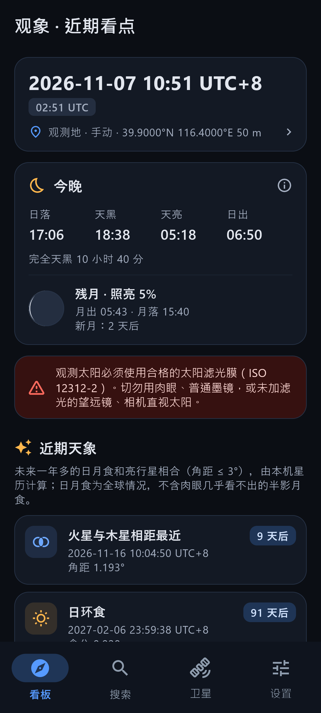
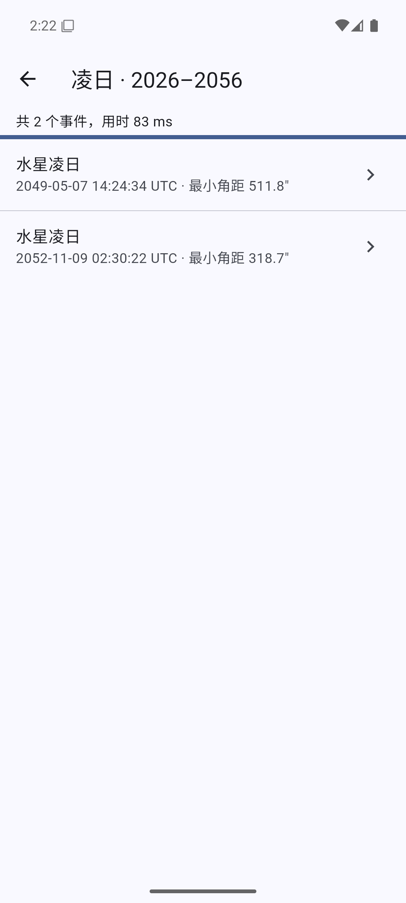
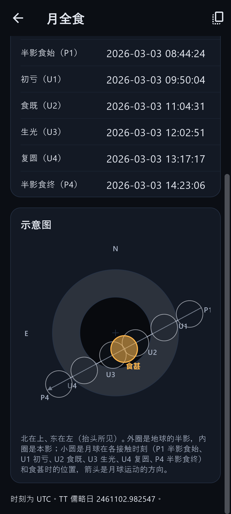
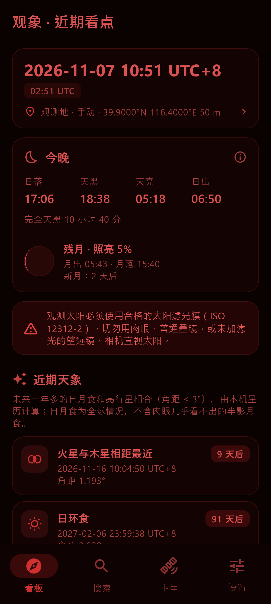

<div align="center">
  
  <h1>观象 · Guanxiang</h1>
  <p><strong>跨平台高精度天文事件搜索与科学可视化工具</strong></p>
  <p>Rust 计算核心 · Flutter 多端客户端（Android / Windows / Linux）· WebAssembly 浏览器版</p>

  <p>
    <a href="https://github.com/huxulm/guanxiang/actions/workflows/ci.yml">
      
    </a>
    <a href="https://github.com/huxulm/guanxiang/actions/workflows/webapp.yml">
      
    </a>
    <a href="LICENSE-MIT">
      
    </a>
    <a href="https://app.guanx.huxulm.dev">
      
    </a>
  </p>

  <p>
    <a href="https://guanx.huxulm.dev">官方网站与安装包下载</a> ·
    <a href="https://app.guanx.huxulm.dev">Web 在线体验版</a> ·
    <a href="docs/PLAN.md">技术规划与精度报告</a>
  </p>
</div>

---

> [!CAUTION]
> **太阳观测安全警示**：无论何时观测日食或水/金星凌日、卫星凌日，都**必须使用符合 ISO 12312-2 国际标准的专用日食减光镜/巴德膜**。切勿裸眼直视太阳，也严禁使用普通墨镜、曝光胶片或透过未安装前端合格滤光膜的望远镜/相机直接观测。

---

## 核心特性

- **🌞 日月食搜索与互动模拟（1900–2100）**
  - 计算全球概况与测站本地可见性（初亏、食既、食甚、生光、复圆、持续时间及沙罗序列号）。
  - **Web 版实时仿真（60 fps）**：贝塞尔基本面正射投影、站心天顶朝上日面（含临边昏暗与全食几何日冕）、等距圆柱世界地图（阴影区轮廓与局部 4× 聚焦模式）、时间轴彩色阶段条与键盘快捷键。
  - **创作与传播工具**：支持 **9:16 竖屏全屏演示**、纯前端 **1080p 视频缩时录制导出**（MP4 / WebM）、**3× 超高清天文海报生成** 以及标准 **`.ics` 日历日程导出**。
- **🪐 行星合冲与水金凌日**
  - 支持任意双天体的合、冲、角距极小值搜索，以及 21 世纪水星凌日、金星凌日的精确预报与本地可见性过滤。
- **🌙 月掩星**
  - 支持月球掩行星及 550 颗亮星（精简自 Hipparcos 星表）的全球查找与测站本地掩始、掩终时刻计算。
- **🛰️ 人造卫星凌日 / 凌月**
  - 基于 CelesTrak OMM/TLE 轨道根数与 SGP4 模型，搜索国际空间站（ISS）、中国空间站（天宫）等航天器的凌日、凌月事件，在地图上绘制精确地面中心线与可见带宽，支持 Android 后台周期刷新与通知提醒。
- **🔭 今晚天象看板**
  - 即时展示今日太阳与月球的升落时间、民用/航海/天文晨昏蒙影时刻、月相照亮比例以及近期重点天象倒计时。
- **🎨 暗适应三套主题 & 隐私优先**
  - 提供**浅色（Light）**、**深空（Deep Space）**与**夜间红光（Red Night）**三套主题（红光模式在 CI 中严格校验所有 UI 色值由红色分量主导，保护野外暗适应视力）。
  - 核心计算完全本地离线执行（内置裁剪版 JPL DE440s 星历，仅卫星根数与底图瓦片需联网）；地理坐标只保存在本机。

---

## 界面预览

| 今晚天象与即将到来 | 按年份分组搜索结果 | 日月食细节与图解 | 夜间红光护眼模式 |
| :---: | :---: | :---: | :---: |
|  |  |  |  |

---

## 计算精度与验证基准

`guanxiang-core` 采用纯 Rust 实现（工作区禁止 `unsafe`），基于 **JPL DE440s 星历**（`anise`）与 **IAU 2006/2000A 岁差章动标准**（`sofars`），全链路持续与独立天文软件及权威星表逐条比对：

| 计算项目 | 独立对照来源 | 实测最大偏差 |
|---|---|---|
| 天体视位置 | Skyfield / JPL Horizons | ≤ `0.0004″` |
| 行星合、冲时刻 | Skyfield | ≤ `0.002 s` |
| 日月食极大时刻与类型 | NASA 五千年日月食星表 | ≤ `2.3 s`（全类型与沙罗号 100% 一致） |
| 月食持续时间 | NASA 五千年星表 | ≤ `0.5 min` |
| 日食食分栅格 | 独立站心算法 | ≤ `0.002` |
| 月掩星时刻 | Skyfield | ≤ `0.003 s` |
| 卫星凌日/凌月接近时刻 | Skyfield (`python-sgp4`) | ≤ `0.007 s` |
| 日月出没与晨昏蒙影 | Skyfield | ≤ `0.03 s` |
| 月下点位置 | Skyfield | ≤ `0.01″` |

---

## 仓库结构

```text
guanxiang/
├── crates/
│   ├── guanxiang-core/    # 纯 Rust 计算核心（时间尺度、ΔT、星历、视位置、事件搜索、SGP4）
│   ├── guanxiang-view/    # CLI scene 与 Web 共用的展示层数据与动画状态求值
│   ├── guanxiang-cli/     # 命令行工具（info、position、distance、search、eclipse、occultation、satellite、scene）
│   └── guanxiang-wasm/    # 面向浏览器的 WebAssembly 接口
├── app/                   # Flutter 跨平台客户端（Android / Windows / Linux；app/rust/ 为 FRB 2.13 桥接层）
├── webapp/                # Web 应用（Vite 8 + Svelte 5 + TypeScript + Tailwind 4 + Web Worker）
├── website/               # 官方网站静态站点
├── tools/                 # 对照校验（Skyfield/Horizons/NASA）、数据生成、打包与图标脚本
├── data/                  # 本地星历存放目录（不入库）
└── docs/                  # 架构规划与各版本发版记录（docs/PLAN.md）
```

---

## 快速开始与本地构建

### 1. 获取星历文件

星历文件较大，不随 Git 仓库分发。运行测试或本地编译前请先下载 **JPL DE440s**（若用于 App 或 Web 端，需裁剪至 1900–2100 年区间）：

```sh
# 1. 下载原始 de440s.bsp 到 data/
curl -fL -o data/de440s.bsp https://naif.jpl.nasa.gov/pub/naif/generic_kernels/spk/planets/de440s.bsp

# 2. 生成裁剪版星历（22 MB，SHA-256: 1b7ff150cbc00d364f584ad65dad651129fde4ab2e7aa23f9551dc9b9674afaa）
cargo run --release -p guanxiang-core --example trim_spk -- \
  data/de440s.bsp data/de440s_1900_2100.bsp 1899-12-01 2101-02-01
```

### 2. Rust 核心测试与命令行工具

要求 Rust 工具链（`rust-version = "1.85"`，edition 2024）：

```sh
# 代码规范、Lint 与工作区完整测试
cargo fmt --all -- --check
cargo clippy --workspace --all-targets --locked -- -D warnings
cargo test --workspace --locked

# 使用 CLI 快速查询 2025-09-07 北京月食详情
cargo run -q -p guanxiang-cli -- eclipse --from 2025-09-01 --to 2025-09-30 --kind lunar --at 39.9,116.4
```

### 3. 运行 Web 应用 (`webapp/`)

要求 Node.js 24+ 与 `wasm-pack`（0.14.0+，需安装 `wasm32-unknown-unknown` target）：

```sh
cd webapp
npm ci
npm run wasm            # 编译 crates/guanxiang-wasm → src/wasm/pkg/
npm run data            # 利用裁剪星历预计算首页近 20 年日月食 JSON
npm run test:geometry   # 校验前端贝塞尔投影与 Rust 引擎误差
npm run dev             # 启动本地开发服务器：http://localhost:5173
```

### 4. 运行与构建 Flutter 客户端 (`app/`)

要求 Flutter SDK（项目当前使用 Flutter 3.47+）及对应平台构建环境（Windows 上需开启开发者模式）：

```sh
# 若需携带内置星历运行桌面/移动版，先将裁剪星历复制到 app/assets/
cp data/de440s_1900_2100.bsp app/assets/de440s_1900_2100.bsp

cd app
flutter analyze
flutter test
flutter run -d windows   # 或指定 Android 模拟器/真机设备
```

更多关于 Android 签名配置、NDK、Windows 安装包与 Linux 打包细节，请参见 [app/README.md](app/README.md) 与 [AGENTS.md](AGENTS.md)。

---

## 致谢与数据来源

- **星历数据**：NASA/JPL DE440s Ephemeris
- **基本天文算法与时间尺度**：IAU SOFA（通过 [`sofars`](https://crates.io/crates/sofars) 使用）与 [`anise`](https://crates.io/crates/anise)
- **卫星轨道根数与传播**：[CelesTrak](https://celestrak.org/) 与 [`sgp4`](https://crates.io/crates/sgp4)
- **星表与对照**：Hipparcos Star Catalog、NASA Five Millennium Canon of Solar/Lunar Eclipses、Skyfield、JPL Horizons
- **地图底图**：© OpenStreetMap contributors / 高德地图

---

## 开源许可证

本项目采用 **MIT** 或 **Apache-2.0** 双重开源许可，您可以任选其一遵守：

- [MIT License](LICENSE-MIT)
- [Apache License, Version 2.0](LICENSE-APACHE)

Copyright © 2026 [Huxulm](https://github.com/huxulm).
